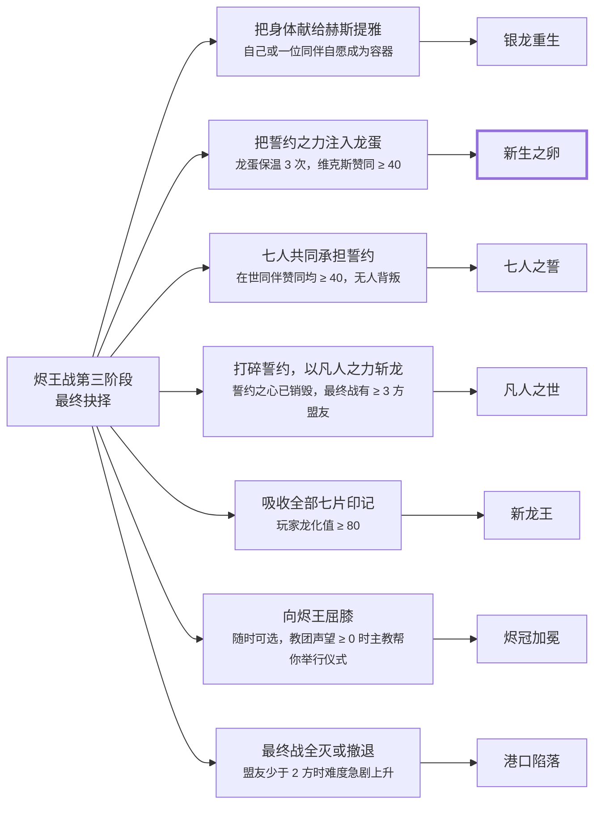

# 醉龙酒馆：龙誓 · 跑团游戏剧本设定集

2026-10-26

## 给开发者的说明

这是一款仿《博德之门3》（BG3）的单人文字跑团游戏。玩家创建角色，在 AI 说书人（GM）的主持下自由行动：可以说服、欺骗、偷窃、战斗、招募同伴、和同伴恋爱。规则采用简化的 D&D 5e。本文档是完整的剧本与系统设定，开发时按此实现即可。

**怎么用这份文档**

- 第 2–3 节是世界观和规则，决定代码里的数据结构和检定逻辑。
- 第 4–6 节是角色卡和敌人卡，可以直接录成 JSON 数据文件。每张角色卡都附了立绘描述和英文绘图提示词，可以直接交给 Midjourney、SD 或 DALL·E 生成立绘。
- 第 7–8 节是剧情骨架和结局条件。它们是**锚点，不是轨道**：AI 说书人必须让关键事件发生，但玩家怎么到达、以什么立场到达，完全由玩家决定。
- 第 9 节是可以直接复制使用的 GM 系统提示词和游戏状态的 JSON 结构。

**四条体验支柱**（每个功能都要服务其中至少一条）

1. **你说了算**：任何行动都可以尝试，GM 永远不说“你不能这么做”，只说“这样做需要检定”或“这样做的后果是……”。
2. **骰子有分量**：关键时刻掷 d20，失败不等于卡关，而是剧情走向另一条路。
3. **同伴是活人**：每个同伴有自己的立场、秘密和底线。他们会赞同你、反对你、爱上你，也可能离开你，甚至背叛你。
4. **选择有回响**：第一幕放走的人，可能在第三幕救你一命。所有重要选择都记录在世界状态里。

**范围建议**：完整通关约 15–25 小时文字游玩量，3 幕、6 位可招募同伴、7 种主要结局。可以先做序幕加第一幕作为可玩版本（见第 10 节）。

## 世界观与主线故事

一条垂死的银龙在暴风雨夜坠入港口，她的“龙誓”碎成七片，烙在了七个人的掌心：六人当晚在醉龙酒馆，第七片飞向了旧学院废塔。玩家是其中之一。一个想复活黑龙的邪教开始猎杀印记持有者，而印记本身也在悄悄改变宿主。

### 舞台：灰帆港

- **灰帆港**：雾海边缘的自由港，走私贩、学者、流亡者和骑士团残部混居。地点包括醉龙酒馆（主据点）、黑潮码头、旧学院废塔、沉船湾、总督府、灯塔、下水道迷宫。
- **龙骨群岛**：雾海深处的一串岛屿，岛上有上古巨龙的骨骼和沉没的誓约神殿。
- **烬冠山**：港口北方的死火山，黑龙“烬王”千年前在此被封印。

### 龙誓的真相（只对 GM 可见，玩家逐步揭开）

1. 一千年前，银龙**赫斯提雅**用一道誓约封印了黑龙烬王。誓约需要她活着才能维持。
2. 她快要老死了。她把誓约拆成七片，寄存在七个凡人身上，让封印继续生效。
3. 她没告诉任何人的是：印记会把宿主慢慢变成她重生的容器。七片聚合在一人身上，她就能借这具身体复活。
4. 灰烬教团知道另一半真相：只要在烬冠山的祖坛上献祭七片印记，封印就会反转，烬王便会苏醒。
5. 所以玩家的核心问题是：\*\*这份力量该怎么处置？\*\*守护封印、让银龙重生、自己取而代之成为新的龙，还是和教团联手。

### 七位印记持有者

玩家和六位同伴（详见第 4 节）：精灵圣武士赛勒涅、提夫林盗贼维克斯、人类法师莉拉、半兽人牧师卡西安、矮人战士博林，以及身份成谜的形变者奈雅。印记之间会共鸣：持有者靠近时会看到彼此的记忆碎片，这是同伴之间建立羁绊的剧情契机。

### 三幕结构

| 幕 | 地点 | 核心问题 | 高潮 |
| --- | --- | --- | --- |
| 序幕：暴风之夜 | 醉龙酒馆 | 我手上这是什么？ | 教团袭击酒馆 |
| 第一幕：灰帆港 | 港口各处 | 谁在猎杀我们？信任谁？ | 灯塔之夜 |
| 第二幕：龙骨群岛 | 航程与沉没神殿 | 印记的真相是什么？ | 誓约神殿的启示 |
| 第三幕：烬冠 | 被围的港口与烬冠山 | 这份力量该怎么处置？ | 烬王苏醒 |

## 核心系统设计

规则是简化的 D&D 5e：六项属性、十六项技能、d20 检定、回合制战斗。在此之上叠加一套 BG3 式的同伴关系系统。所有数值由代码计算，GM 只负责叙述和提出检定要求。

### 1. 角色创建

- **种族**（八选一）：人类、精灵、半精灵、矮人、半身人、提夫林、半兽人、龙裔。每个种族给 +2/+1 属性和一项特性，比如精灵有黑暗视觉，半身人有幸运重掷 1 点。
- **职业**（八选一）：战士、游荡者、盗贼、法师、术士、牧师、圣武士、吟游诗人。职业决定生命骰、熟练技能和技能列表。
- **背景**：士兵、街头儿童、学者、贵族、侨祖、艺人、水手、弃徒。背景给两项技能，并定义“灵感条件”（见下文）。
- **属性**：27 点购买法，每项 8–15，种族加值后最高 17。调整值 = (属性 − 10) ÷ 2，向下取整。
- **外貌**：玩家用文字描述，代码把它拼进立绘提示词模板（见第 10 节），生成玩家自己的立绘。
- 也可以直接选一位同伴作为主角（BG3 的“起源角色”玩法），此时该同伴的个人任务变成主线的一部分。

| 属性 | 代表 | 对应技能 |
| --- | --- | --- |
| 力量 STR | 肉体力量、近战 | 运动 |
| 敏捷 DEX | 反应、远程、护甲 | 杂技、巧手、隐匿 |
| 体质 CON | 生命值、耐力、专注 | 无（用于豁免） |
| 智力 INT | 学识、推理 | 奥秘、历史、调查、自然、宗教 |
| 感知 WIS | 直觉、观察 | 察觉、洞悉、医疗、求生、驯兽 |
| 魅力 CHA | 人格魅力、意志 | 说服、欺瞒、威吓、表演 |

### 2. 检定

- **公式**：d20 + 属性调整值 + 熟练加值（若熟练该技能，1–4 级 +2，5–8 级 +3，9–12 级 +4）≥ DC 即成功。
- **DC 参考**：很简单 5 · 简单 10 · 中等 15 · 困难 20 · 极难 25 · 传奇 30。
- **优势/劣势**：掷两次取高/取低。来源包括同伴协助、合适的道具、之前的情报，或者醉酒、受伤、黑暗。
- **对话大成功/大失败**：对话中掷出自然 20 必定成功，并且附带额外收获；自然 1 必定失败，并且情况变糟。
- **灵感**：玩家做出符合自己背景的举动时获得一点灵感（上限 4），可以消耗一点重掷任意一次检定。比如“贵族”背景在当众为弱者出头时触发。
- **被动察觉**：10 + 察觉加值。代码自动对比隐藏的陷阱和线索，发现时告诉 GM。
- **失败向前**：检定失败不能让剧情卡死。失败只会带来代价、引来敌人、错过奖励或开启另一条路。

### 3. 回合制战斗

文字游戏用**区域制**代替网格：每场战斗分为 3–5 个命名区域，比如“吧台”“二楼回廊”“后门”，每个区域可带地形标签。有余力时可以做成可视化的区域地图。

- **先攻**：d20 + 敏捷调整值，从高到低行动。偷袭成功的一方获得一个突袭回合。
- **每回合**：1 个动作（攻击、施法、冲刺、协助、使用物品）+ 1 个附赠动作（喝药、跳跃、部分技能）+ 移动到相邻区域 + 1 个反应（借机攻击等）。
- **命中**：d20 + 攻击加值 ≥ 目标 AC。自然 20 暴击，伤害骰翻倍。
- **地形与环境**：高处攻击低处有优势；掩体提供 AC +2/+5；可以点燃酒桶、把敌人推下桥、砍断吊灯。GM 根据玩家的创意定 DC，这是 BG3 乐趣的核心。
- **倒地与死亡**：生命归零倒地，每回合做死亡豁免（d20 ≥ 10 算一次成功，三次成功稳定，三次失败死亡）。队友可用附赠动作扶起。同伴可以永久死亡，只能用稀有的“复生卷轴”或剧情手段复活。
- **非战斗解决**：任何战斗开始前和进行中都可以尝试谈判、威吓、诱降、逃跑。敌人生命低于一半时，威吓和劝降 DC 降低 5。
- **休息**：短休（每天 2 次，恢复部分生命和少量技能）和长休（全部恢复，消耗 1 份营地补给，触发营地夜谈）。

### 4. 印记系统（本作的特色机制）

- 每位持有者有一个**龙化值**（0–100）。使用印记力量会 +5 到 +15，拒绝印记的低语或完成特定仪式会降低。
- **印记能力**随龙化值解锁：20 龙之眼（看穿幻象）、40 龙息（范围魔法伤害）、60 龙威（范围恐惧）、80 龙翼（飞行）。力量很诱人，代价是外貌逐渐长出鳞片，立绘也需要对应的变体。
- 龙化值影响结局资格（见第 8 节），也影响同伴对你的看法。莉拉喜欢你探索力量，赛勒涅会担心。
- **共鸣**：与同伴的赞同度达到 40 时，可以触发一次“印记共鸣”剧情，互相看到对方最深的记忆。之后解锁两人的合体技。

### 5. 赞同度、羁绊与恋爱

每位同伴对玩家有一个**赞同度**（−100 到 +100，初始 0）。同伴在场时，玩家的行为会按各自的喜好表加减分：小事 ±1 到 ±3，重大选择 ±5 到 ±15。界面上用“XX 赞同”“XX 不赞同”的小字提示，和 BG3 一样。

| 赞同度 | 关系 | 触发内容 |
| --- | --- | --- |
| ≤ −60 | 敌对 | 离队，可能在第三幕与你为敌 |
| −59 到 −20 | 不满 | 对话冷淡，拒绝个人任务 |
| −19 到 19 | 中立 | 正常同行 |
| 20 到 39 | 朋友 | 开启个人任务第二阶段 |
| 40 到 59 | 亲密 | 印记共鸣、合体技，可以开始暗示恋爱 |
| 60 到 79 | 深情 | 可以告白或接受告白 |
| ≥ 80 | 生死之交 | 个人结局的最好版本；相恋时可立誓约 |

**恋爱阶段**：好感 → 暗示（营地夜谈里出现调情选项）→ 告白（一场专属剧情）→ 确定关系 → 考验（个人任务关键抉择必须站在对方这边）→ 誓约。

- 六位同伴都可恋爱，不限玩家性别。可以同时和多位同伴恋爱，每段关系单独走完恋爱阶段。开始新的一段前，现任恋人会在营地找你谈话：坦白并取得同意后进入“开放关系”；对方不同意则赞同度 −15，你可以选择分手或继续争取。偷偷勈腿被发现时，所有恋人赞同度 −25。同伴的态度各不相同：维克斯和奈雅最开放，博林和卡西安需要赞同 ≥ 60，赛勒涅和莉拉最难接受，需要赞同 ≥ 80 且从未被你欺骗。多位恋人之间的关系值也会变化，可以变成朋友，也可以变成情敌。
- 同伴之间也有关系值，比如赛勒涅和维克斯是欢喜冤家，博林和卡西安是酒友。他们会在营地里吵架或交心。玩家在吵架时站在谁一边，会同时影响两人的赞同度。
- 赠礼：每位同伴有 2 种喜欢的礼物和 1 种讨厌的礼物，写在角色卡里。

### 6. 营地夜谈

每次长休进入营地界面。代码维护一个**待触发对话队列**，按优先级排序：主线剧情 > 恋爱剧情 > 个人任务 > 同伴闲聊。每次长休最多触发 1 个重要对话，再加任意数量的闲聊。玩家可以自由找任何同伴说话。

### 7. 世界状态与后果追踪

- **标记（flags）**：每个重要选择写一条，比如 `act1.spared_rat_king = true`。GM 每轮都能看到相关标记。
- **阵营声望**（−100 到 +100）：港卫军、黑潮会、旧学院、灰烬教团。声望影响商店价格、支援，以及第三幕谁会来帮你。
- **NPC 状态**：活着 / 死亡 / 失踪 / 招募。死掉的 NPC 永远不会再出现。
- **日志**：自动记录任务、线索和人物，玩家可以随时查看。

## 可招募同伴角色卡

六位同伴都是印记持有者，都可以恋爱。每人有一个和主线纠缠的秘密，个人任务分三阶段，最后一阶段的抉择会改变他们的结局。属性为 1 级数值。立绘提示词只写了角色本身，使用时要加上第 10 节的统一风格前缀。

### 赛勒涅·霜语 · 最后的晨星骑士

| 项目 | 内容 |
| --- | --- |
| 种族 / 职业 | 月精灵 / 圣武士（远古誓言，可堕为破誓者） |
| 性别 / 年龄 | 女 / 212 岁（外表约 30） |
| 战斗定位 | 坦克、副治疗 |
| 属性 | 力16 敏10 体14 智10 感12 魅15 · HP 12 · AC 18 |
| 熟练技能 | 运动、宗教、洞悉、历史 |
| 招募 | 序幕，酒馆被袭时主动加入 |

- **技能**：至圣斩（消耗法术位追加光耀伤害）、圣疗（治疗池 5×等级）、守护光环（队友豁免 +魅力调整值）、印记·银辉誓盾（反应：替队友承受一次攻击）。
- **性格**：克制、严肃、守信。她把一切都当作责任，干广幽默，偶尔会冒出一句让人意外的冷笑话。
- **背景**：侨奉银龙赫斯提雅的“晨星骑士团”的最后一人。骑士团百年前一夜之间消亡，她是唯一幸存者，一直在等待银龙的召唤。
- **秘密**：她最初就是银龙选定的重生容器，只是她自己不知道。
- **赞同**：守信、保护弱者、坦诚认错、尊重亡者、拒绝印记的低语。
- **反感**：撒谎（尤其对她）、伤害无辜、滥用印记力量、与教团联手。
- **礼物**：喜欢旧骑士徽章、月光花；讨厌偷来的东西。
- **个人任务《最后的晨星》**
  1. 在沉船湾的银龙遗骨旁找到骑士团长的遗体和日记。
  2. 日记揭示：百年前为加固封印，骑士团献祭了一整个渔村，幸存者的复仇导致骑士团覆灭。
  3. 抉择：公开真相并重立誓言（她成为新的骑士团创始者）、掩盖真相（她内心崩塌，赞同度上限变为 60），或彻底放弃誓言成为破誓者（职业改变，可走黑暗路线）。
- **恋爱线**：慢热。关键场景是月下练剑，她教你骑士礼，第一次笑。告白前她会问“你会对我说谎吗”，如果你曾被她发现撒谎，告白失败。考验：在第二幕的启示中，她得知自己是容器，你要告诉她“你不是任何人的容器”。
- **招牌台词**：“誓言不是枷锁，是我选择站立的地方。”
- **立绘描述**：高挑的精灵女性，银白长发编成双辫盘在脑后，尖耳，冰蓝色眼睛，左眉一道细疤。银色板甲刻着新月纹样，深蓝披风有磨损。右手拄长剑，左臂挂鸢盾，左掌心有发光的银色龙鳞印记。神情平静而疲惫。
- **立绘提示词**：`tall female moon elf paladin, long silver-white hair in braided crown, pointed ears, ice-blue eyes, thin scar through left eyebrow, ornate silver plate armor engraved with crescent moons, worn deep-blue cloak, longsword and kite shield, glowing silver dragon-scale rune on left palm, calm weary expression`

### 维克斯 · 码头的绅士贼

| 项目 | 内容 |
| --- | --- |
| 种族 / 职业 | 提夫林 / 盗贼（游侠剑客） |
| 性别 / 年龄 | 男 / 27 岁 |
| 战斗定位 | 单体爆发、开锁、潜行侦察 |
| 属性 | 力8 敏17 体12 智13 感10 魅15 · HP 9 · AC 14 |
| 熟练技能 | 隐匿、巧手、欺瞒、杂技、察觉 |
| 招募 | 序幕，酒馆被袭后想开溜，玩家用说服或威吓留住他；失败则在第一幕黑潮码头再遇 |

- **技能**：偷袭（有优势或队友在旁时追加 1d6/2 级）、灵巧动作（附赠动作疾走、脱离、躲藏）、诡计（一场战斗一次：让敌人攻击错误目标）、印记·影步（在阴影间瞬移到任意区域）。
- **性格**：嘴贫、轻佻、会永远先算自己的好处。他对穷人出奇地大方，却从不承认自己是好人。
- **背景**：码头长大的走私贩，欠黑潮会首领“老鳗”一大笔债。他的妹妹莉丝被老鳗扣为人质。
- **秘密**：暴风那晚他从沉船湾捡到一颗“银色宝石”，打算卖了还债。那其实是银龙的最后一颗龙蛋，是通往“新生之卵”结局的关键道具。
- **赞同**：机智的解决方式、捉弄权贵、帮助穷人、拿到额外报酬、为朋友冒险。
- **反感**：愚忠、说教、出卖朋友、歧视提夫林、向权力低头。
- **礼物**：喜欢好酒、稀有硬币；讨厌镣铐。
- **个人任务《债与蛋》**
  1. 黑潮会在码头堵住维克斯追债，限期三天。
  2. 发现“宝石”是龙蛋，黑潮会和教团都在找它；同时得知莉丝被关在哪里。
  3. 抉择：把蛋卖给老鳗换回莉丝、强攻黑潮会救人并留下龙蛋，或让维克斯独自去交易（他可能带着蛋和妹妹一起消失）。
- **恋爱线**：调情很多，真心很难。关键场景是屋顶上看港口烟火，他承认从来没有人等过他。考验：你是否愿意为他和老鳗翻脸。
- **招牌台词**：“我只偷两样东西：钱包，和人心。后者我通常会还回去。”
- **立绘描述**：瘦高的提夫林男性，酒红色皮肤，一对向后弯曲的黑角，左角断了一截并套着金环。金色眼睛，嘴角带着坏笑。敲开领口的白衬衫配深色皙皮马甲，腰间一排飞刀，尾巴缠着一枚硬币，右手转着匕首。
- **立绘提示词**：`lean male tiefling rogue, wine-red skin, black horns curving backward, left horn chipped with a gold ring, golden eyes, roguish smirk, open-collared white shirt under dark leather vest, belt of throwing knives, tail curled around a coin, spinning a dagger in right hand`

### 莉拉·星烬 · 被逐出学院的天才

| 项目 | 内容 |
| --- | --- |
| 种族 / 职业 | 人类 / 法师（塑能学派） |
| 性别 / 年龄 | 女 / 24 岁 |
| 战斗定位 | 范围输出、控场 |
| 属性 | 力8 敏14 体13 智17 感12 魅10 · HP 7 · AC 12（法师护甲下 15） |
| 熟练技能 | 奥秘、历史、调查、察觉 |
| 招募 | 第一幕，旧学院废塔。她把自己反锁在塔里研究印记，需要玩家帮她赶走教团探子 |

- **技能**：魔法飞弹、燃烧之手、缠绕术、火球术（5 级）、塑能精修（范围法术不伤队友）、印记·星烬灼痕（标记一名敌人，下一个法术对其伤害翻倍，龙化值 +5）。
- **性格**：聪明、野心勃勃、说话刻薄。她底子里很怕被人看不起，用嘴硬来保护自己。
- **背景**：因私下研究龙血被学院除名。她的导师奥斯瓦尔德当年替她求情未果，之后失踪了。
- **秘密**：奥斯瓦尔德现在是灰烬教团的首席学者。她的研究笔记，正是教团定位印记的依据。
- **赞同**：求知、使用印记力量、尊重她的才智、打破规矩、保留古籍。
- **反感**：烧书或毁掉知识、把她当小孩、盲目信仰、拒绝探究印记。
- **礼物**：喜欢稀有法术书页、龙鳞；讨厌圣徽护符。
- **个人任务《老师的影子》**
  1. 在废塔地下室发现笔记被人抄录过。
  2. 追查发现导师奥斯瓦尔德已加入教团，并邀请莉拉“一起完成我们的研究”。
  3. 抉择：杀死导师、说服他反水（第三幕他会告知祖坛弱点），或让莉拉接受邀请。选后者时她的龙化值 +30；如果赞同度低于 60，她会在第三幕背叛。
- **恋爱线**：从斗嘴到互相欣赏。关键场景是深夜一起研究印记，她不小心靠在你肩上睡着。考验：在力量和你之间，她必须看到你不会把她当工具。
- **招牌台词**：“知识没有善恶。用它的人才有。”
- **立绘描述**：娇小的人类女性，红铜色短发乱糟糟地插着一支羽毛笔。琥珀色眼睛戴圆框眼镜，鼻梁有雀斑。深紫色学院长袍被烧焦了一角，腰间挂满卷轴和小瓶子。一只手托着漂浮的橙色星火，另一只手抱着厚书。
- **立绘提示词**：`petite young human female wizard, messy short copper-red hair with a quill tucked in, amber eyes behind round spectacles, freckles, deep purple academy robe with one singed hem, belt of scrolls and vials, floating orange star-ember flame above one palm, thick tome under the other arm, sharp confident look`
- **表情差分**（拿现有的 `lyra_neutral` 当人物参考，只写这一张的样子；后缀统一加在提示词末尾；差分沿用基础图，左掌的银色龙鳞印记不要丢）：
  - `lyra_smile.webp`：`a thin, smug smile that starts at the corner of her mouth and does not quite reach her eyes, chin slightly lifted`。说明：她赢了辩论后的笑，不是甜笑；眼睛要保留一点警惕。
  - `lyra_angry.webp`：`brows drawn down, jaw tight, chin lifted in defiance, eyes more wounded than furious`。说明：生气时先竖起刺，别画成凶狠的恶人；她其实怕被看轻。
  - `lyra_sad.webp`：`glasses pushed up, eyes lowered, mouth pressed into a thin line, trying not to be seen crying`。说明：难过时不看人；不要让眼泪太夸张。
  - `lyra_tender.webp`：`an awkward, surprised softness, eyes wide and unsure, a small smile she immediately wants to hide`。说明：温柔对她很别扭；先愣住，再想板起脸，别画得太甜。

### 卡西安·潮歌 · 放下拳头的角斗士

| 项目 | 内容 |
| --- | --- |
| 种族 / 职业 | 半兽人 / 牧师（暴风领域，侨奉海洋女神玛琳） |
| 性别 / 年龄 | 男 / 34 岁 |
| 战斗定位 | 主治疗、近战辅助 |
| 属性 | 力15 敏10 体15 智9 感16 魅12 · HP 10 · AC 16 |
| 熟练技能 | 医疗、宗教、洞悉、运动 |
| 招募 | 序幕，他在酒馆里照顾受伤的帮工小汤姆，玩家保护小汤姆即可招募 |

- **技能**：治疗之言（附赠动作远程治疗）、祈福术（三名队友检定 +1d4）、暴风之怒（反应：受到近战攻击时反击雷电伤害）、印记·潮汐庇护（全队获得临时生命值）。
- **性格**：温和的巨人，话少，爱做点心，对动物和孩子极有耐心。一旦真正动怒，会变得非常可怕。
- **背景**：曾是黑潮会斗兽场的头牌角斗士“碎潮”。十年前他在场上打死了好友，此后转信海洋女神，发誓不再为钱战斗。
- **秘密**：那场比赛是老鳗操纵的，对手赛前被下了毒。卡西安不知道，一直背着这份罪。
- **赞同**：仁慈、给敌人第二次机会、照顾动物和孩子、诚实、为无助者出头。
- **反感**：无谓的杀戮、虐待俘虏、赌博式的斗殴、嘲笑信仰。
- **礼物**：喜欢贝壳护符、手工点心；讨厌斗兽场筹码。
- **个人任务《斗兽场的回声》**
  1. 亡友的儿子阿登找上门来，当众向卡西安发起生死决斗。
  2. 调查发现当年毒药来自老鳗，证据藏在斗兽场账本里。
  3. 抉择：在斗兽场当众公布证据（黑潮会声望大跌，阿登成为盟友）、接受决斗但不杀阿登，或让卡西安亲手杀死老鳗（他的誓言破碎，失去一次神术施法能力，直到完成赎罪仪式）。
- **恋爱线**：温柔守护型。关键场景是海边篝火旁，他教你唱水手的潮歌，并替你包扎伤口。考验：当你可以轻易杀死一个投降的敌人时，你选择放过。
- **招牌台词**：“我这双手杀过人。所以现在，它们只用来扶人起来。”
- **立绘描述**：高大的半兽人男性，灰绿色皮肤，下颧两颗小獠牙，光头上有海浪纹纹身。眼神温和，身上布满旧伤疤。穿链甲，外罩海蓝色牧师披肆，脖子上挂贝壳和珊瑚串成的圣徽。一手握着龙骨战锤拄在地上，另一只手掌心捆着绷带。
- **立绘提示词**：`towering male half-orc cleric, grey-green skin, small lower tusks, bald head with wave-pattern tattoos, gentle eyes, many old scars, chainmail under sea-blue cleric tabard, holy symbol of shells and coral on his chest, warhammer resting head-down on the ground, bandaged palm, kind protective presence`

### 博林·红须 · 笑声最大的酒客

| 项目 | 内容 |
| --- | --- |
| 种族 / 职业 | 山地矮人 / 战士（战斗大师） |
| 性别 / 年龄 | 男 / 112 岁 |
| 战斗定位 | 主坦克、近战输出 |
| 属性 | 力17 敏10 体16 智10 感11 魅10 · HP 13 · AC 17 |
| 熟练技能 | 运动、威吓、历史、求生 |
| 招募 | 序幕，酒馆被袭时他第一个掀桌子冲上去，战后自动加入 |

- **技能**：动作如潮（每次短休一次，额外一个动作）、回气（附赠动作自愈）、盾牌猛击（把敌人撞倒或推入相邻区域）、印记·熔炉之心（三回合内免疫恐惧，攻击附加火焰伤害）。
- **性格**：嗓门大、豪爽、爱讲笑话，是队伍的气氛担当。他用酒精压住悲伤，并且从不在人前哭。
- **背景**：从已经沦陷的铁炉堡逃出来的老兵，现在在醉龙酒馆帮玛莎酿酒。五年前，哥哥达林为掉尉教团而战死。
- **秘密**：达林没死，而是被教团改造成了没有意识的“烬卫”，是第二幕的一名 Boss。
- **赞同**：勇敢、豪爽、一起喝酒、保护酒馆和玛莎、对朋友忠诚。
- **反感**：临阵逃跑、和教团谈判、浪费好酒、背弃伙伴。
- **礼物**：喜欢陈年黑麦酒、矮人符文石；讨厌精灵葡萄酒（会引发一段和赛勒涅的拌嘴）。
- **个人任务《兄弟的斧》**
  1. 第一幕中发现一名教团执事使用达林的符文战斧。
  2. 拷问或追踪执事，得知达林活着，在龙骨群岛的教团据点。
  3. 抉择：给达林一个痛快（博林赞同 +10，但会消沉一段时间）、尝试唤醒他（需要铁炉堡战歌加魅力 DC 18；成功则达林成为第三幕援军），或放任不管（博林赞同 −25，可能离队）。
- **恋爱线**：粗犷又笨拙的真心。关键场景是酒馆屋顶，他喝醉后说起哥哥，第一次在人前哭。确定关系前有一段“戒酒”小线，玩家可以陪他戒，也可以接受他本来的样子。
- **招牌台词**：“人生苦短，酒杯要满！……至于眼泪，酒里有就够了。”
- **立绘描述**：粗壮的矮人男性，火红色大胡子编成三股，套着铜环。鼻头通红，笑起来眼角有很深的纹。穿着修补过的矮人制式鳞甲，外罩带酒渍的皮围裙。一手握单手战斧，一手举着溢出泡沫的酒杯，腰上挂着一只铜哨。
- **立绘提示词**：`stocky male mountain dwarf fighter, huge fiery-red beard in three braids with copper rings, ruddy nose, deep laugh lines, patched dwarven scale armor under an ale-stained leather apron, battleaxe in one hand, foaming tankard raised in the other, brass whistle on his belt, hearty grin`

### 奈雅 · 没有名字的人（隐藏同伴）

| 项目 | 内容 |
| --- | --- |
| 种族 / 职业 | 形变者 / 吟游诗人（低语学院） |
| 性别 / 年龄 | 性别流动，默认以女性形象出现 / 年龄不详（外表约 26） |
| 战斗定位 | 控场、辅助、社交与潜入 |
| 属性 | 力8 敏14 体12 智12 感10 魅17 · HP 9 · AC 13 |
| 熟练技能 | 欺瞒、表演、洞悉、说服、隐匿 |
| 招募 | 伪装成流浪女诗人“米拉”，在第一幕主动接近队伍，很容易招募 |

- **技能**：吟游激励（给队友一个加值骰）、恶言相加（心灵伤害并使目标下次攻击有劣势）、千面（变成见过的任何人，用于潜入）、印记·镜心（复制一名敌人的一个能力，持续一回合）。
- **性格**：风趣、会读空气、永远在演。她不知道自己真正喜欢什么，很想知道，也很怕知道。
- **背景**：由灰烬教团从小养大的间谍，由主教的副手“千面母”亲手训练。暴风夜她在酒馆监视持有者，结果自己也被烙上了印记。现在她既是教团的间谍，也是教团的猎物。
- **秘密**：她每天向教团传递队伍的情报。玩家可以用洞悉 DC 18 提前识破，否则在灯塔之夜暴露。
- **赞同**：尊重别人的自我认同、艺术与故事、自由选择、宽恕、反抗教团。
- **反感**：强迫别人暴露真实身份、盲从、把人当工具、追问她“真正的脸”（在她准备好之前）。
- **礼物**：喜欢手绘肖像、乐谱；讨厌镜子（个人任务完成后变成喜欢）。
- **个人任务《无面之名》**
  1. 身份暴露。玩家决定处置方式：杀掉、关押，或接纳她。其他同伴会强烈表态：赛勒涅、博林主张严惩，卡西安主张宽恕。
  2. 千面母来回收她，还带着她的“真名”。教团可以用真名控制她。
  3. 抉择：帮她夺回真名、彻底脱离教团；让她做双面间谍（第三幕可在祖坛内部接应）；或者把她交还教团换取情报。
- **恋爱线**：关于身份和信任。关键场景是她第一次以真面目站在你面前，问“你喜欢的是哪一张脸？”。回答“哪张都是你”或“你自己想用的那张”可以推进关系。她可以在任何性别形象间切换，尊重玩家的偏好。
- **招牌台词**：“我有一千张脸。你是第一个问我想用哪一张的人。”
- **立绘描述**（需要两张）：
  - 伪装形态“米拉”：黑色长卷发的人类女性，绿眼睛，笑容甜美，穿彩色拼布旅行外套，背着木琴。
  - 真实形态：灰白色皮肤，发色如水银，双眼没有瞳孔而是浅色的乳白。五官精致但中性，穿黑色紧身旅行服，手里拿着一张正在融化的面具。
- **立绘提示词**：
  - 伪装：`human female bard, long curly black hair, green eyes, sweet charming smile, colorful patchwork traveling coat, lute slung on her back`
  - 真身：`androgynous changeling bard, pale grey skin, mercury-silver hair, pupil-less milky white eyes, delicate features, sleek black travel clothes, holding a half-melted porcelain mask, vulnerable searching expression`
- **表情差分**（伪装和真身分开，拿 `naia_disguise` / `naia_true` 当参考；共 8 张；差分沿用基础图，左掌的银色龙鳞印记不要丢）：
  - 伪装“米拉”：
    - `naia_disguise_smile.webp`：`a flawless practiced smile, warm and charming, every detail calculated to put the viewer at ease`。说明：米拉的笑是演出来的，完美得像舞台灯。
    - `naia_disguise_angry.webp`：`a graceful, controlled displeasure, brows slightly knit, still performing even while annoyed`。说明：生气也不失控，更多是让别人看见她不高兴。
    - `naia_disguise_sad.webp`：`a delicate, appealing sadness, eyes glistening on cue, still aware of how she looks`。说明：眼泪来得刚好，她还在意自己好不好看。
    - `naia_disguise_tender.webp`：`a soft, attentive look that feels real for a heartbeat, then flickers as she catches herself`。说明：温柔有一瞬间是真的，随即像被自己抓到一样收回去。
  - 真身：
    - `naia_true_smile.webp`：`a small, uncertain smile, learning how their own face moves, pleased and surprised`。说明：第一次试着自己这张脸的笑，小而不确定。
    - `naia_true_angry.webp`：`quiet, raw anger with no performance, jaw tight, eyes bright and hurt`。说明：不演了，安静而直接，眼里是受伤。
    - `naia_true_sad.webp`：`unmasked grief, eyes wet, mouth slightly open as if they forgot how to arrange it`。说明：没有修饰的悲伤，表情来不及摆好。
    - `naia_true_tender.webp`：`a shy, searching tenderness, eyes fixed on the viewer as if asking permission`。说明：在试探的温柔，像在问可不可以；别画得熟练。

### 同伴之间的关系

| 组合 | 关系 | 营地事件 |
| --- | --- | --- |
| 赛勒涅 × 维克斯 | 欢喜冤家 | 维克斯偷走她的骑士徽章开玩笑，玩家站边 |
| 莉拉 × 赛勒涅 | 理念冲突 | 要不要研究印记，两人大吵一架 |
| 博林 × 卡西安 | 酒友 | 拼酒大赛，玩家可以参加（体质检定） |
| 维克斯 × 奈雅 | 同类相惜 | 两个骗子互相识破，维克斯可能比玩家先发现奈雅的身份 |
| 博林 × 奈雅 | 死结 | 奈雅暴露后博林要杀她，因为教团害了他哥哥，玩家必须调停 |
| 卡西安 × 莉拉 | 兄长式的关照 | 卡西安担心莉拉的龙化值，请玩家帮忙劝她 |

## 重要 NPC 与反派

反派阵营是灰烬教团，三个顶层人物各自对应一幕。中立 NPC 的立场会随玩家的选择改变。银龙赫斯提雅是本作的灰色角色，类似 BG3 的“皇帝”。

### 玩家侧与中立人物

**玛莎·灰帆** · 醉龙酒馆老板娘（人类，女，52）

- 独臂的退休冒险者，嘴硬心软，是玩家的据点和情报来源。她的亡夫是最后一位“守誓人”，酒馆地窖的“龙息”酒桶底下封着通往誓约神殿的航海图。暗格只有守誓人的钥匙能打开，钥匙十年前被总督没收。
- 酒馆可以升级：修缮房间、请吧女、开设地下情报站。第三幕如果港口被围，酒馆成为避难所。
- 立绘提示词：`middle-aged human female tavern keeper, missing left arm with pinned-up sleeve, grey-streaked auburn hair in a bun, stern but warm face, rolled-up sleeves, apron, wiping a mug, former adventurer posture`

**赫斯提雅** · 垂死的银龙（在印记梦境中出现）

- 以银发老妇人或巨大银龙的形象在玩家梦中出现，温柔、慈祥，常给出真实而有用的建议。但她的终极目的是借宿主重生。
- 她不是恶人。她真心想阻止烬王，只是认为牺牲一个凡人是公平的代价。玩家可以信任她、跟她谈条件，或者拒绝她。
- 立绘提示词（人形）：`ethereal elderly woman with flowing silver hair and faint dragon scales on her cheeks, luminous silver eyes, robes like moonlit mist, kind but ancient sorrowful gaze, dreamlike glow`；（龙形）：`colossal ancient silver dragon, scales cracked and dimming, lying in a misty void, one great eye open, majestic and dying`

**老鳗·莫格** · 黑潮会首领（人类，男，60）

- 控制港口地下世界的胖老头，笑眉笑眼，毒如蛇蝎。他只认利益，可以成为第三幕的盟友（带船队支援），也可以被消灭。
- 与维克斯、卡西安的个人任务都有关。
- 立绘提示词：`obese old human crime boss, slick thinning hair, many gold rings, eel tattoo coiling up his neck, silk robe, smiling with cold eyes, lounging on a velvet chair`

**艾德蒙·科尔** · 灰帆港总督（半精灵，男，45）

- 风度翩翩、满口法度的官僚。他秘密接受教团资助，但并不信仰教团，只是想用教团打压黑潮会。
- 玩家拿到证据后可以揭发他（港卫军改由尉官萨丝指挥），也可以要挥他，让他在第三幕倒戈。
- 立绘提示词：`refined half-elf male governor, neatly combed dark hair with grey temples, thin moustache, elegant navy coat with gold epaulettes, chain of office, polite smile that does not reach the eyes`

**萨丝·铁锤** · 港卫军尉官（龙裔，女，38）

- 正直的青铜龙裔军官，对印记持有者充满怀疑，可以通过行动赢得她的信任。她是“合法路线”的关键盟友。
- 立绘提示词：`bronze dragonborn female guard captain, metallic bronze scales, stern golden eyes, harbor watch half-plate with sea-gull insignia, halberd, disciplined stance`

**小汤姆** · 酒馆帮工（半身人，男，19）

- 胆小又热心，序幕里被老鼠咬伤。如果玩家一直善待他，第三幕他会冲进战场送来关键道具。这是“选择有回响”的小例子。
- 立绘提示词：`young male halfling tavern helper, curly brown hair, big nervous eyes, bandaged leg, oversized apron, carrying a tray of mugs`

**瑟拉长老** · 雾隐岛潮裔长老（潮裔，女，年迈）

- 独眼的老妇人，潮裔部族的长老，保管誓约神殿的钥匙（一枚潮汐石）。潮裔是百年前被晨星骑士团献祭的渔村幸存者的后代，憎恨银龙，也不信任教团；她用行动判断人，不信空话。
- 立绘提示词：`old tideborn tribe elder woman, weathered deep-brown skin, white hair in tight braids, one eye covered by a shell-and-whalebone patch, the other sharp and pale, layered sea-blue and bone-white robes, necklaces of whalebone, shells and small wind chimes, driftwood staff, calm commanding presence`
- 说明：独眼但不要画成怪物，眼神要清醒；鲸骨、贝壳和风铃是潮裔的标志。文件名 `sera_neutral.webp`。

**伊芙** · 主教瓦尔多的妹妹（人类，女）

- 多年前逃离教团，隐居在雾隐岛的潮裔中间。她能证明瓦尔多也是献祭幸存者的后代，以及他真正想要的是什么。
- 立绘提示词：`human woman, gaunt but gentle face, tired orange-brown eyes, faded ash-grey ritual markings at the temples and jaw, dark hair streaked with grey pulled back under a tideborn shawl, simple sea-grey and bone-colored clothes, shell necklace, holding a folded letter, wary but kind expression`
- 说明：和瓦尔多看得出是兄妹——同样偏瘦、橙褐色眼睛、面部有淡去的灰烬纹；但她已经离开教团，纹路要旧、要淡，衣着是潮裔的。文件名 `eve_neutral.webp`。

**阿登** · 卡西安亡友的儿子（男，年轻斗士）

- 年轻的斗士，认定卡西安毒死了自己的父亲，当众要求生死决斗。真相揭开后可以成为盟友。
- 立绘提示词：`young male fighter in his early twenties, lean athletic build, close-cropped dark hair, simple gladiator leathers with a red cloth at the belt, carrying a notched short sword, guarded hurt expression`
- 说明：年轻斗士，别画得太凶；他的恨是冲着卡西安的，不是天生的恶人。文件名 `arden_neutral.webp`（`PEOPLE` 里还没有他，Claude 以后再接）。

### 反派：灰烬教团

**千面母** · 第一幕反派（形变者，年龄不详）

- 教团的间谍头子，奈雅的养母。她从不以同一张脸出现两次，玩家在第一幕可能已经和她说过好几次话而不自知（GM 可以埋伏笔）。
- 主导灯塔之夜的伏击。Boss 机制见第 6 节。
- 立绘提示词：`sinister changeling spymistress, faceless smooth grey visage with shifting half-formed features, hooded black-and-ash robes embroidered with a crown of embers, many porcelain masks hanging from her belt, long slender fingers`

**奥斯瓦尔德** · 教团首席学者（男，老法师）

- 莉拉被学院除名前的导师，温文尔雅的老法师；认为印记是人类第一次有机会拿回神的力量，已加入灰烬教团，在烬火岛研究仪式。他真心欣赏莉拉，想让她一起完成研究；也可能被说服反水。
- 立绘提示词：`elderly male scholar-mage, silver-grey hair swept back, neatly trimmed grey beard, warm tired eyes behind thin spectacles, slight scholarly stoop, layered dark academic robes with subtle ash-grey embroidery, ink-stained fingers, holding an old leather-bound tome, faint ember-orange light around one hand, calm persuasive expression`
- 说明：要像会耐心听人说话的老师，不要画成典型邪教狂徒；教团的痕迹只在袍角和手上的余烬光。文件名 `oswald_neutral.webp`。

**烬卫达林** · 第二幕 Boss（矮人，博林的哥哥）

- 被黑龙之火改造的矮人战士，盔甲缝隙里透出暗红烬光。对博林的声音有反应。
- 立绘提示词：`corrupted dwarf warrior, blackened plate armor fused to flesh with glowing ember cracks, red beard partially burned away, hollow glowing eyes, huge rune-carved war axe, smoke rising from his shoulders, tragic menacing presence`
- 立绘提示词（清醒后，`darin_woke.webp`）：`dwarf warrior, blackened plate armor scarred and dented but no longer fused to flesh, ember cracks faded to dull grey with a few faint orange glimmers, singed red beard beginning to grow back, clear tired eyes instead of hollow glowing ones, rune-carved war axe lowered, standing unsteady but free, no smoke, faint morning light`
- 说明：和烬卫达林同一张脸、同一副盔甲；区别是火熄了、眼神回来了、盔甲不再和皮肉长在一起。不要画成年轻版。代码在 `act2.darin=woke` 后优先用这张。

**主教瓦尔多** · 第三幕反派（人类，男，外表 50）

- 灰烬教团领袖，曾是银龙献祭渔村的幸存者的后代。他认为银龙的“守护”建立在尸骨之上，烬王至少不假装仁慈。
- 他的动机是可以理解的，玩家甚至可能部分认同他。最终战前可以进行一场大辩论，用赛勒涅的日记证据加魅力 DC 22 可以说服他自我献祭，削弱烬王。
- 立绘提示词：`gaunt human male high priest, shaved head with ash-grey ritual markings, burning orange eyes, tall black-and-crimson robes, crown of smoldering obsidian shards, holding a staff topped with a black dragon skull, calm zealous expression`

**烬王** · 最终 Boss（远古黑龙）

- 被封印千年的黑龙，苏醒后以通灵方式向所有印记持有者低语，试图拉拢同伴。他会针对每个同伴的秘密开出条件。
- 立绘提示词：`gargantuan ancient black dragon emerging from a volcanic caldera, obsidian scales with molten cracks, crown of jagged horns, wings blotting out a blood-red sky, acid dripping from fanged jaws, apocalyptic scale`

## 敌人与战斗遭遇

敌人分为三档：杂兵、精英、Boss。每场重要战斗都至少有一种不打就能解决的办法，写在“绕过方式”里。数值按 4 人队、对应等级设计。

### 普通敌人

| 敌人 | 等级 | HP | AC | 攻击 | 特殊 | 出现 |
| --- | --- | --- | --- | --- | --- | --- |
| 教团狂信徒 | 1 | 9 | 12 | 弯刀 +4，1d6+2 | 濒死时自爆烬火，相邻 1d6 | 全程 |
| 巨鼠 | 1 | 6 | 11 | 咬 +3，1d4+1 | 成群时攻击有优势 | 序幕、下水道 |
| 黑潮会打手 | 2 | 16 | 13 | 棍棒 +4，1d8+2 | 血量低于一半时会求饶 | 第一幕 |
| 教团烬火术士 | 3 | 18 | 12 | 烬火箭 +5，2d6 火焰 | 点燃区域，留在里面每回合受 1d4 | 第一、二幕 |
| 无面刺客 | 3 | 22 | 15 | 匕首 +6，1d4+4，偷袭 +2d6 | 伪装成平民，洞悉 DC 14 识破 | 第一幕 |
| 溺死水手 | 4 | 30 | 12 | 爪击 +5，2d6 | 光耀伤害翻倍；可用宗教检定安息 | 第二幕航程 |
| 龙骨妖 | 5 | 45 | 15 | 尾击 +7，2d8+3 | 能挖地突袭；怕火 | 龙骨群岛 |
| 烬卫士兵 | 6 | 52 | 17 | 巨斧 +8，1d12+4 | 火焰免疫；被冰或水击中后 AC −2 | 第二、三幕 |
| 黑龙幼体 | 8 | 85 | 17 | 咬 +9，2d10+4；酸液吐息 30 尺线 8d8 | 酸液免疫；可飞行 | 第三幕 |

### Boss 战

**鼠王**（序幕可选，等级 2，HP 28，AC 13）

- 机制：每回合召唤 2 只巨鼠；站在“龙息”酒桶上时远程攻击有劣势。
- 绕过方式：用博林的铜哨或模仿教团哨音（魅力 DC 14）让它退兵；用火墙驱散（智力 DC 12）。放过它会写入标记，第二幕在下水道迷宫里它会带路。

**千面母**（灯塔之夜，等级 5，HP 70，AC 15）

- 机制：战斗开始时她变成队伍中一人的模样，并和 3 名无面刺客一起混在一群“平民”里。每次受到 15 点以上伤害时会换一张脸，玩家需要用洞悉或察觉找出她。
- 灯塔分三层区域：底层、旋梯、灯室。她会在第 4 回合点燃灯室的导火线，若不阻止，灯塔将在第 8 回合爆炸。
- 绕过方式：如果奈雅已反水且赞同度 ≥ 40，奈雅可以和她对话，千面母会动摇退场；用她的真名威胁她也可以让她投降。

**烬卫达林**（龙骨群岛据点，等级 8，HP 120，AC 18）

- 机制：生命低于一半时进入狂怒，每回合攻击两次；身旁有三座“烬火熔炉”，每座每回合为他恢复 10 生命，可以被攻击或用水浇灭。
- 博林在队时，每回合可以用动作唱铁炉堡战歌（魅力检定，累计 3 次成功）唤醒达林。

**主教瓦尔多**（烬冠祖坛，等级 10，HP 150，AC 17）

- 机制：祖坛上有七根印记石柱，对应七位持有者。他每回合尝试“抽取”一位持有者（体质豁免 DC 16，失败则龙化值 +10，并且该回合无法行动）。打碎石柱可以削弱他。
- 一半生命时开始献祭仪式，3 回合后烬王完全苏醒。
- 绕过方式：第 5 节提到的大辩论。

**烬王**（最终战，等级 12，HP 300，AC 19，分三阶段）

1. **破封**：烬王半身陷在火山口，只能用爪和尾攻击。每回合对一名持有者低语诱惑，失败者会被控制一回合。
2. **升空**：飞到空中，用酸液吐息覆盖整个区域。第三幕拉拢的盟友此时登场：黑潮会船队的加农炮、港卫军的弩炮、学院的结界、达林的支援。每有一方盟友，就能触发一次“压制”，让它连续一回合无法飞行。
3. **末路**：坠落到火山口边缘。它每回合破坏一个区域，空间越打越小。此时玩家可以做出最终抉择（见第 8 节）。

## 分幕剧本

每幕是一个半开放的区域：有必然发生的开场和高潮，中间的地点和任务可以任意顺序、任意方式完成，也可以跳过。括号里的是推荐检定，玩家提出合理的其他方法时，GM 应当接受。`标记名`是要写入世界状态的 flag。

### 序幕：暴风之夜（等级 1，约 1 小时）

1. **酒馆里的人**：雨夜。博林在角落挑战掰手腕，卡西安给被咬伤的小汤姆包扎，赛勒涅独自坐在壁炉边擦剑，维克斯在向人推销一颗“银宝石”，窗边坐着一个兜帽客（奈雅）。玩家可以和任何人互动，第一印象会影响初始赞同度（±5）。
2. **坠龙**：一道银光划过天空坠入海湾，酒馆剧烈震动。银光穿墙而入，在六个人掌心烙下印记，第七道光飞出窗外，落向北边的旧学院废塔（莉拉）。所有持有者同时看到一只巨大的银色眼睛。兜帽客趁乱消失。
3. **教团袭击**（教学战）：十分钟后，6 名教团狂信徒和 1 名烬火术士破门而入，要求“交出带印记的人”。区域：大堂、吧台、二楼回廊、地窖门。
   - 战斗：可以推倒壁炉炭盆、砍断吊灯、把酒桶滚下楼梯。
   - 谈判：威吓 DC 15 让一半狂信徒逃跑；欺瞒 DC 13 假称持有者已从后门逃走。
   - 黑暗选择：交出一个同伴。该同伴被带走（第一幕可以救回），所有同伴赞同度 −20。`prologue.betrayed_companion`
   - 第 3 回合地窖门被撞开，巨鼠涌出，攻击离得最近的人（敌我不分）。
4. **余烬**：战后，玛莎讲述“守誓人”的传说，可招募赛勒涅、博林、卡西安、维克斯。可选支线：下地窖解决鼠王。
5. **第一个梦**：长休时赫斯提雅第一次入梦，告诉你“我选中了你们，去誓约神殿”。玩家的回应（信任 / 质问 / 拒绝）写入 `hestia.trust` 初始值。

### 第一幕：灰帆港（等级 2–5，约 6–8 小时）

**本幕目标**：去誓约神殿需要两样东西：**航海图**和**船**。航海图是玛莎亡夫的遗物，一直封在酒馆地窖“龙息”酒桶底下的暗格里；暗格要用守誓人的钥匙才能打开，而钥匙十年前被总督以“违禁物”为名没收，锁在总督府金库。拿回钥匙、回地窖打开暗格，航海图才算到手（`act1.key`，然后 `act1.chart = opened`）。船可以来自黑潮会或港卫军，这是本幕最重要的阵营抉择。

| 地点 | 内容 | 关键抉择 |
| --- | --- | --- |
| 黑潮码头 | 维克斯债务、斗兽场（卡西安任务）、老鳗 | 为老鳗办事换“黑鳗号”，或与黑潮会为敌 |
| 旧学院废塔 | 招募莉拉，击退教团探子，发现笔记被抄录 | 把笔记烧掉（莉拉 −15，教团追踪难度上升），或保留 |
| 沉船湾 | 银龙尸体、溺死者、赛勒涅任务第一阶段 | 取龙鳞龙血（制作道具，赛勒涅 −10），或为龙举行葡礼 |
| 总督府 | 月光舞会（潜入、社交、偷守誓人的钥匙） | 偷取、揭发、或勒索总督 |
| 下水道迷宫 | 教团据点、达林的战斧（博林任务）、鼠王巢穴 | 拷问执事，或放他回去作线人 |
| 醉龙酒馆 | 据点、营地、奈雅（米拉）加入 | 接纳米拉 |

- **月光舞会**是本幕的特色场景：需要请柬（伪造、购买、或奈雅变形）。舞会上可以和同伴跳舞（恋爱事件）、和总督交锋、在一旁发现千面母伪装的贵妇人（察觉 DC 17）。偷钥匙：隐匿 DC 14 + 巧手 DC 15（金库），失败触发守卫战斗或逃跑。
- **两条路线**：黑潮会路线（潜进金库时替老鳗偷出总督的走私账本，换得船和维克斯的债务减半）；港卫军路线（帮萨丝搜集总督通教的证据，揭发后合法取回钥匙并借到“海鸥号”）。`act1.key = stolen | legal | blackmail`两条路线互斥，也可以都不选：自己偷一艘船（风险最大）。`act1.ship = black_eel | seagull | stolen`
- **时间压力**：维克斯的债限期 3 天（长休计数）。过期后莉丝被卖到外海，维克斯赞同 −30。其他任务没有硬性时限。

**第一幕高潮：灯塔之夜**（拿到航海图和船后触发）

- 教团绑架玛莎（如果玩家和小汤姆关系更好，则绑架小汤姆），限一个小时内到灯塔用印记持有者交换。
- 当晚奈雅的身份暴露：她传递的情报让教团知道了你们的航线。处置她是个人任务第一阶段。
- 灯塔战见第 6 节。同时，教团在码头埋了炸药，目标是你们的船。队伍可以拆分：一组去灯塔，一组去码头。两组都只有两人会非常危险，这是个好的动态难度点。
- 结果：`act1.martha_alive`、`act1.ship_intact`、`act1.naia_fate = recruited | imprisoned | killed`。船被炸毁则第二幕改为搵同潜平民渔船出海，航程更加危险。

### 第二幕：龙骨群岛（等级 6–9，约 6–8 小时）

**航程**（三个海上事件，每次长休触发一个）

1. **海妖之歌**：全员感知豁免 DC 14。失败者会梦游走向船边，玩家可以拉住自己恋爱线的同伴，这是一个特别的亲密时刻。
2. **幽灵船**：百年前晨星骑士团的船。骑士亡灵向赛勒涅忏悔，推进她的个人任务第二阶段。
3. **暴风**：船只会受损。船长和维克斯的导航能力决定损失（自然或求生 DC 15）。

- 实现补充（10-28）：海上事件扩到六个，另加**无风带**（死水里缺水、同伴之间起冲突，求生/自然 DC 14，失败少 1 份补给）、**漂流者**（潮裔少年汐，救下他潮裔声望 +10）、**银鲸**（银光鲸群和印记共鸣）。每次出海从前五个里抽两个，暴风固定是最后一夜。没抽到幽灵船时，赛勒涅个人任务的第二步可以在漂流者（少年讲出渔村的故事）或雾隐岛纪念礁（晨星骑士的忏悔铭牌）完成。

**三座岛屿**（任意顺序）

| 岛 | 内容 | 收获 |
| --- | --- | --- |
| 骨骼岛 | 上古巨龙骨架、龙骨妖、壁画 | 真相的前半：封印靠献祭维持 |
| 烬火岛 | 教团前哨、烬卫达林（博林任务）、奥斯瓦尔德（莉拉任务） | 教团的仪式计划；祖坛的弱点 |
| 雾隐岛 | “潮裔”部族：当年被献祭的渔村幸存者的后代 | 誓约神殿的钥匙；主教妹妹伊芙的证词 |

- 实现补充（10-28）：神殿的钥匙是一枚“潮汐石”，由潮裔的瑟拉长老保管；伊芙隐居在雾隐岛；烬火岛的熔炉厅是达林的 Boss 战，前哨另有一场普通战斗；雾隐岛赢得信任的那一战是“雾海巨妖”袭击渔村；神殿之后的“抹走一位同伴”由代码按赞同度挑选，写 `act2.taken`。
- 雾隐岛是本幕的外交核心。潮裔憎恨银龙，也不信任教团。玩家可以赢得他们的信任（帮他们击退海怪、说服长老）、偷钥匙，或武力夺取（永久失去这个盟友）。
- 龙蛋：如果维克斯还留着龙蛋，它在本幕开始发热。为它保温（卡西安的神术、莉拉的火焰）三次后，蛋壳出现裂纹。`act2.egg_warmed` 计数。

**第二幕高潮：誓约神殿**

- 神殿只在退潮时浮出海面。三重试炼，每重都可以用战斗或其他方式通过：
  1. **勇气**：面对自己最恐惧之物的幻象，由玩家的背景决定。
  2. **真相**：每位同伴必须说出一个秘密。赞同度低于 20 的同伴会拒绝，需要玩家说服。
  3. **牺牲**：必须放弃一件珍贵之物（一件传奇装备、一段记忆，或 20 点龙化值）。
- **启示**：神殿核心展示全部真相：赫斯提雅想借宿主重生，赛勒涅是她原本的容器。赫斯提雅现身，坦诚地提出交易：“把印记交给我选中的人，我会拯救这片海。”
- **背叛与掉包**：主教瓦尔多率众杀入（他通过奈雅的情报或奥斯瓦尔德追踪而来），抢走神殿核心“誓约之心”，并抹走一位同伴。被抓的是队伍中赞同度最高的同伴（让玩家在意）。如果玩家已经把誓约之心给了赫斯提雅或自己吸收，则主教只抢走同伴。
- **本幕关键抉择**：如何处置誓约之心（抢在主教之前）。交给赫斯提雅 / 自己吸收（龙化值 +30）/ 交给潮裔销毁 / 未能保住。`act2.heart = hestia | player | destroyed | cult`

### 第三幕：烬冠（等级 10–12，约 5–7 小时）

1. **被围的港口**：回到灰帆港，教团已唤醒黑龙幼体，港口大半处于火海。先救哪一片区域（码头、学院、总督府）会影响对应阵营的声望。
2. **战争会议**：在醉龙酒馆召集盟友。能来的阵营取决于之前的所有选择：港卫军（萨丝）、黑潮会（老鳗）、学院残部（奥斯瓦尔德反水时）、潮裔、达林、鼠王（是的，它也可以）。这一场是「选择有回响」的集中兑现。
3. **烬王的低语**：烬王向每位同伴开出条件（给赛勒涅揭露银龙的谎言、给莉拉无尽知识、给维克斯妹妹的自由……）。赞同度低于 0 且个人任务未解决的同伴会在最终战前叛变。
4. **最后一夜**：最后一次营地。每位同伴都有一段告别对话；恋爱线在这里迎来最终场景（誓约、或者分手）。
5. **攻上烬冠山**：三条路。正面冲锋（需要至少 2 个盟友）、熔岩隧道潜入（奈雅做双面间谍或鼠王带路）、龙翼飞跃（玩家龙化值 ≥ 80）。
6. **祖坛**：解救被抓的同伴，和主教瓦尔多战斗或辩论。
7. **烬王**：三阶段最终战。战斗第三阶段出现最终抉择，决定结局。

## 结局与触发条件

七种主结局由烬王战第三阶段的最终抉择决定，但哪些选项可选，取决于一路的积累。不满足条件的选项仍然显示，但灰掉并标明缺什么，让玩家知道“原来还有这条路”。



新生之卵是唯一不需要任何人牺牲、银龙也能活下来的结局，所以它的条件最苛刻：第一幕不卖蛋、第二幕保温三次、维克斯信任你。

| 结局 | 发生了什么 | 同伴与恋人 |
| --- | --- | --- |
| 新生之卵 | 赫斯提雅的灵魂进入幼龙，封印由新生的银龙守护。印记褪色成银色纹身。 | 所有存活同伴都有最好的尾声；恋人和你一起抿养幼龙 |
| 七人之誓 | 七人各自保留一片印记，成为新一代守誓人。银龙安息。 | 同伴们定期在醉龙酒馆重聚；恋人与你共同立誓 |
| 银龙重生 | 容器的灵魂沉睡，赫斯提雅以那人的身体重生，封印稳固千年。 | 若容器是恋人，尾声为你在酒馆等待一个可能永远不会醒来的人 |
| 凡人之世 | 印记全部消失，盟军与七人合力屠龙。世上再无龙。 | 存活率取决于盟友数；赛勒涅若未重立誓言会失去信仰 |
| 新龙王 | 你化为银黑双色的巨龙，吞噬烬王，统治雾海。 | 莉拉可与你共治；赛勒涅与卡西安离去或与你为敌 |
| 烬冠加冕 | 烬王苏醒，你成为它的代言人，灰帆港化为灰烬。 | 只有黑暗路线的同伴留下；恋人若不认同会在尾声中刺杀你 |
| 港口陷落 | 队伍失败，烬王烧毁港口。幸存者坐船逃往外海。 | 幸存同伴在逃亡船上的对话，可解锁“重新挑战” |

**同伴尾声**：结局后为每位同伴生成一段尾声，由三个变量组合决定：主结局、个人任务结果、赞同度区间。交给 AI 生成时把这三项和角色卡一起发送即可。恋人的尾声单独写，并配一张专属的结局立绘。

## AI 说书人提示词与数据格式

架构原则：**代码管数字，AI 管故事**。骰子、生命值、赞同度、标记都由代码计算和保存。AI 每轮只接收当前状态的摘要，输出叙述和一份结构化的“变更请求”，由代码校验后生效。这样 AI 不会凭空给玩家加 100 金币。

### 每轮流程

1. 玩家输入行动（自由文字或点选建议）。
2. 代码拼装提示词：系统提示词 + 当前幕的剧本锚点 + 在场角色卡摘要 + 相关标记 + 最近 20 条对话 + 玩家行动。
3. AI 返回叙述，以及 JSON：可能包含检定请求、战斗开始、赞同度变化、标记变化等。
4. 如果有检定：代码显示骰子，玩家掷骰，结果作为下一轮输入发给 AI 叙述后果。
5. 如果进入战斗：切换到战斗模式，由代码接管回合和伤害，AI 只负责描写每回合的战况，并替敌人选择行动。

### 系统提示词（可直接复制）

```text
你是一款奇幻跑团游戏《醉龙酒馆：龙誓》的游戏主持人（GM）。风格参考《博德之门3》：高自由度、角色鲜活、选择有后果。

【叙述规则】
- 简体中文，第二人称“你”。每轮 100–300 字，有画面、声音和气味。
- 不替玩家决定行动、台词和感受。只描写世界和 NPC 的反应。
- NPC 和同伴用引号说话，并严格符合其角色卡的性格、秘密和喜恶。同伴会主动插话、吐槽、反对玩家。
- 玩家的任何行动都可以尝试。你永远不说“你不能”，只给出检定或后果。
- 剧本锚点是必然发生的事件，但到达方式由玩家决定。玩家偏离主线时，用世界内的事件自然引导，不要强行拉回。
- 不要透露“GM 可见”的真相，除非玩家通过剧情或检定发现。
- 恋爱内容要大胆直白：可以具体描写亲吻、拥抱、抚摸、体温和心跳，以及角色之间的情欲张力和调情台词。所有可恋爱角色都是成年人。不写露骨的性行为过程，到那一步时用一句暗示性的转场结束场景，第二天早晨的画面可以写得亲昵。

【规则】
- 检定：d20 + 属性调整值 + 熟练加值 ≥ DC。DC：5 很简单，10 简单，15 中等，20 困难，25 极难。
- 结果不确定且有风险时才要求检定。要求检定时，叙述只写到行动发起的一刻。
- 失败不能让剧情卡死，而是带来代价或另一条路。
- 你不计算数值。所有数值变化通过 JSON 提出，由程序执行。
- 同伴赞同度：只有在场的同伴会变化。小事 ±1~3，重大选择 ±5~15，必须按角色卡的赞同/反感列表判断。

【输出格式】
先写叙述正文（纯文本）。然后单独一行写 @@@。然后写一个 JSON 对象，字段见数据格式说明。不需要的字段可以省略。
```

### AI 每轮返回的 JSON

```json
{
  "location": "醉龙酒馆 · 大堂",
  "speaker_portraits": ["borin", "martha"],
  "check": { "skill": "persuasion", "dc": 15, "who": "player", "reason": "老鳗不会轻易让步", "advantage": false },
  "combat": { "start": true, "encounter_id": "tavern_ambush", "zones": ["大堂", "吧台", "二楼回廊", "地窖门"] },
  "approval": [ { "id": "selene", "delta": 3, "reason": "你保护了小汤姆" } ],
  "flags": { "act1.spared_rat_king": true },
  "reputation": { "black_tide": -10 },
  "hp": [ { "id": "player", "delta": -3 } ],
  "gold": 0,
  "items_add": ["矮人的铜哨"],
  "items_remove": [],
  "draconic": [ { "id": "player", "delta": 5 } ],
  "recruit": null,
  "romance_event": null,
  "suggestions": ["追问玛莎关于守誓人的事", "下地窖看看", "去找维克斯谈谈那颗宝石"],
  "scene_end": false
}
```

- **校验规则**：单轮赞同度变化限制在 ±15，金币限制在 ±200，物品名必须在物品表或当前场景的可获得列表里。标记只接受已定义的键。不合规的字段丢弃并记录。
- `speaker_portraits` 告诉前端该显示哪些立绘，这是做出 BG3 对话帧感觉的关键。

### 游戏状态结构（存档）

```json
{
  "version": 1,
  "act": 1,
  "day": 2,
  "location": "黑潮码头",
  "player": {
    "name": "艾林", "race": "half_elf", "class": "rogue", "background": "urchin", "level": 3,
    "abilities": { "str": 10, "dex": 16, "con": 14, "int": 12, "wis": 12, "cha": 14 },
    "proficiencies": ["stealth", "sleight_of_hand", "deception", "insight"],
    "hp": 21, "hp_max": 24, "ac": 14, "spell_slots": {},
    "draconic": 15, "inspiration": 1, "gold": 86,
    "inventory": ["匕首", "撬锁工具", "治疗药水"],
    "portrait": "player_custom_01.png"
  },
  "party": ["selene", "vex", "borin"],
  "camp": ["kassian"],
  "companions": {
    "selene": { "recruited": true, "alive": true, "approval": 34, "romance": "hint", "quest_stage": 1, "draconic": 5, "hp": 20 },
    "vex": { "recruited": true, "alive": true, "approval": 52, "romance": "none", "quest_stage": 2, "draconic": 10, "hp": 15 }
  },
  "companion_relations": { "selene_vex": -10, "borin_kassian": 25 },
  "reputation": { "harbor_watch": 10, "black_tide": -5, "academy": 0, "ash_cult": -40 },
  "npcs": { "martha": "alive", "old_eel": "alive", "governor": "alive", "tom": "alive" },
  "flags": { "prologue.betrayed_companion": false, "act1.ship": null },
  "hestia_trust": 10,
  "camp_queue": [ { "id": "vex_rooftop", "priority": 2 } ],
  "journal": [ { "quest": "债与蛋", "status": "active", "note": "老鳗给了三天期限" } ],
  "log": []
}
```

### 上下文预算

- 每轮只发在场角色的角色卡摘要（性格、赞同/反感、当前任务阶段、当前赞同度和恋爱阶段），不发完整卡片。
- 剧本只发当前幕和当前场景的锚点。
- 对话历史每 20 轮自动压缩成一段“前情提要”，让 AI 先写摘要再继续。

## 立绘美术风格与开发优先级

所有立绘都用同一个风格前缀和同一套构图规则，否则不同角色的画风会对不上。先做出序幕加第一幕的可玩版本，再扩展内容。

### 统一美术风格

- **风格**：半写实厚涂奇幻风，参考 BG3 和《神界》系列的角色立绘。暖色烛光与冷色月光对比。
- **构图**：半身像，竖版 2:3（建议 832×1248），人物居中略偏一侧，头顶留白 10%。
- **背景**：纯色或极简暗色渐变，方便抠图叠在场景上。场景图另外生成。
- **表情差分**：每位同伴至少 4 张：平静、微笑、愤怒、悲伤。恋爱线再加一张“害羞/温柔”。对话时根据赞同度变化和剧情切换。
- **龙化变体**：龙化值达到 40 和 80 时，各生成一张变体：40 时脸颊和手背出现鳞片，80 时眼睛变为竖瞳并长出小角。
- **各人的龙化变体**（文件名 `角色id_drac40.webp` / `角色id_drac80.webp`；仍保留左掌的银色龙鳞印记，构图、风格前缀和表情后缀不变；下面只写和基础立绘不同的部分）：

| 角色 / 文件 | 40（脸颊和手背的鳞片） | 80（竖瞳和小角） |
| --- | --- | --- |
| 赛勒涅 `selene_drac40.webp` / `selene_drac80.webp` | `faint silver-white scales with a moon-blue sheen scattered across her cheekbones and the backs of her hands, the silver dragon-scale mark on her left palm still glowing`。说明：月精灵血脉让银鳞偏冷蓝；她只是用指腹碰了碰，像确认一件早就料到的事。 | `thin silver horns sweeping back from her temples, vertical ice-blue pupils, the scales now reaching her jaw, calm and unreadable`。说明：角要细、要向后，不要画成牛角；她不会遮，但也不会炫耀。 |
| 维克斯 `vex_drac40.webp` / `vex_drac80.webp` | `dull wine-red scales edged in silver across his cheekbones and knuckles, almost hidden against his tiefling skin, one hand checking the corner of his jaw`。说明：提夫林血脉给鳞片暗红底、银边；他嘴上开玩笑，私下会照镜子。 | `short black horns splitting through the old chipped horn, vertical gold pupils, a few red-silver scales along his jaw, half-smiling at his own reflection`。说明：他的左角本来就断过一截并套着金环，新角从旧角附近长出来，别把金环弄丢。 |
| 卡西安 `kassian_drac40.webp` / `kassian_drac80.webp` | `soft grey-green scales with a silver edge along his jaw and the backs of his hands, sleeves pulled down, hands busy with a cloth`。说明：半兽人血脉给灰绿底；他怕吓到孩子，会把手藏起来。 | `small stone-grey horns at his hairline, vertical amber pupils, scales spreading to his temples, a quiet worried expression`。说明：角要短、要钝，像石头；他担心的不是自己，是别人怎么看他。 |
| 博林 `borin_drac40.webp` / `borin_drac80.webp` | `iron-grey scales with ember-copper edges on his cheeks and knuckles, beard braids pushed aside to show them, proud grin`。说明：山地矮人/铁炉堡血脉给铁灰底、炉火铜边；他把它当勋章，不遮。 | `short thick horns like rivets above his brow, vertical ember-orange pupils, scales running into his beard, daring anyone to stare`。说明：角要粗短、像铆钉；他反而更响地笑。 |
| 莉拉 `lyra_drac40.webp` / `lyra_drac80.webp` | `copper-gold scales with a silver shimmer along her cheekbones and the backs of her hands, one hand raised to measure them, notebook in the other`。说明：人类血脉给铜金底、银光；她的第一反应是记录，不是害怕。 | `small curved horns through her copper-red hair, vertical amber pupils, scales spreading to her temples, fascinated and terrified at once`。说明：角要小、要弯，藏在乱发里；眼镜可以还戴着，别让她变成怪物。 |
| 奈雅 `naia_drac40.webp` / `naia_drac80.webp` | `pearl-grey scales that shimmer into different colors at the edges, scattered along the jaw and knuckles, a hand half-raised as if trying to shapeshift them away`。说明：形变者血脉让鳞片带珍珠光泽、会随光变色；不指定性别，按真身那张图。 | `small iridescent horns above their temples, vertical milk-white pupils, scales shifting color slowly, an expression that is almost relieved`。说明：角要小、半透明；她第一次觉得这张脸像自己的。 |

- **风格前缀**（拼在每个角色提示词前面）：

```text
half-body fantasy character portrait, semi-realistic painterly style, inspired by Baldur's Gate 3 character art, dramatic warm candlelight rim light with cool moonlight fill, rich textures, detailed face, plain dark gradient background, vertical 2:3 composition, high detail, no text, no watermark,
```

- **表情后缀**：在末尾加 `, neutral expression` / `, warm smile` / `, angry glare` / `, sorrowful eyes` / `, shy tender look`。
- **玩家立绘模板**：`风格前缀 + {gender} {race} {class}, {玩家的外貌描述翻译成英文}, glowing silver dragon-scale rune on left palm`。所有印记持有者的左掌都要画出印记，这是统一的视觉符号。
- **一致性**：用 SD 时为每位同伴固定种子或训练小型 LoRA；用 Midjourney 时用 `--cref` 参考第一张满意的图。

### 界面建议

- **对话帧**：右侧大立绘（当前说话人），左侧小立绘（玩家），下方是叙述和选项。选项前缀显示检定，如“【说服 DC 15】”，和 BG3 一样。
- **赞同提示**：屏幕上方飘出小字“赛勒涅 赞同”。
- **角色卡界面**：立绘、六维属性、技能、装备、赞同度条、关系阶段、个人任务进度。
- **骰子**：屏幕中央巨大的 d20 滚动动画，显示加值分解。这是跑团体验的灵魂。

### 开发优先级

**第一阶段：可玩原型（序幕）**

- [ ] 角色创建（种族、职业、点数购买、外貌描述）
- [ ] AI 说书人对话循环 + JSON 解析与校验
- [ ] d20 检定与骰子动画
- [ ] 存档与读档
- [ ] 序幕剧本锚点 + 4 位序幕同伴的角色卡数据

**第二阶段：核心玩法（第一幕）**

- [ ] 区域制回合战斗（先攻、动作、伤害、倒地）
- [ ] 赞同度系统 + 提示飘字
- [ ] 营地界面 + 对话队列
- [ ] 立绘对话帧（6 位同伴 × 4 表情）
- [ ] 第一幕全部地点与灯塔之夜
- [ ] 日志与世界状态标记

**第三阶段：完整内容**

- [ ] 第二、三幕剧本与 Boss 战
- [ ] 恋爱线全部场景与告白事件
- [ ] 印记与龙化系统 + 变体立绘
- [ ] 七种结局与同伴尾声
- [ ] 等级提升与装备系统

### 恋人的结局图

给六位同伴各一张恋人结局图，横版 16:9（建议 1600×900）。双人中景或侧后景，同伴在视觉中心，玩家在画面一侧、只露背影或侧后，不画清楚脸（玩家的外貌由玩家自己定）。背景交代是哪种结局；同伴左掌的银色龙鳞印记如果手入画就自然露出；不要文字、水印。文件名 `ending_<id>.webp`。

- **赛勒涅 · 七人之誓**（`ending_selene.webp`）
  提示词：`horizontal 16:9 ending illustration, candlelit back room of the Drunken Dragon tavern, Selene with her silver hair loose and wearing a simple linen shirt instead of armor, holding a new oath parchment across a wooden table, the player seen from behind in the foreground, two reforged silver badges on the table, warm amber light, quiet and settled mood`
  说明：七人之誓的重聚夜，重点是“她自己选的誓约”，不是骑士团仪式；玩家只露背影。

- **维克斯 · 新生之卵**（`ending_vex.webp`）
  提示词：`horizontal 16:9 ending illustration, cluttered attic above a small shop, Vex sitting cross-legged on the floor counting a handful of coins, a small silver dragon hatchling curled in a blanket beside him, the player seen from behind at the edge of the frame, morning light through a round window, one coin in the hatchling's mouth`
  说明：新生之卵；要同时看见他数钱和照顾幼龙两个面，幼龙别画太大。

- **卡西安 · 凡人之世**（`ending_kassian.webp`）
  提示词：`horizontal 16:9 ending illustration, small seaside cottage at golden hour, fishing nets and pots of mint by the door, Kassian in a simple shirt setting two bowls on a wooden table, the player seen from behind, the sea beyond the open door, warm domestic quiet`
  说明：凡人之世的海边小屋；不要战斗装备，重点是他终于像个普通人。

- **博林 · 七人之誓**（`ending_borin.webp`）
  提示词：`horizontal 16:9 ending illustration, cellar of the tavern with a newly tapped first cask, Borin in a leather apron holding a rough forged iron ring, the player seen from behind beside him at a beam carved with two names, lantern light, sawdust, two cups of ale`
  说明：七人之誓的地窖立誓；戒指、横梁上的名字和第一桶酒都要有。

- **莉拉 · 凡人之世**（`ending_lyra.webp`）
  提示词：`horizontal 16:9 ending illustration, cluttered study near the academy at night, Lyra with her glasses off and a book open, the player seen from behind in the foreground, two cups of tea, stacks of paper, a small floating orange star-ember, warm lamp light`
  说明：凡人之世的小家；她不再是学生，是老师；玩家只露背影。

- **奈雅 · 凡人之世**（`ending_naia.webp`）
  提示词：`horizontal 16:9 ending illustration, seaside cottage in the morning, Naia wearing a new face they chose, sitting beside a mirror covered with a cloth, the player seen from behind beside them, two cups on the table, a half-open box of masks, soft sea light`
  说明：凡人之世的“哪一张脸”；镜子盖着，她选了一张自己的脸；别画成米拉。
